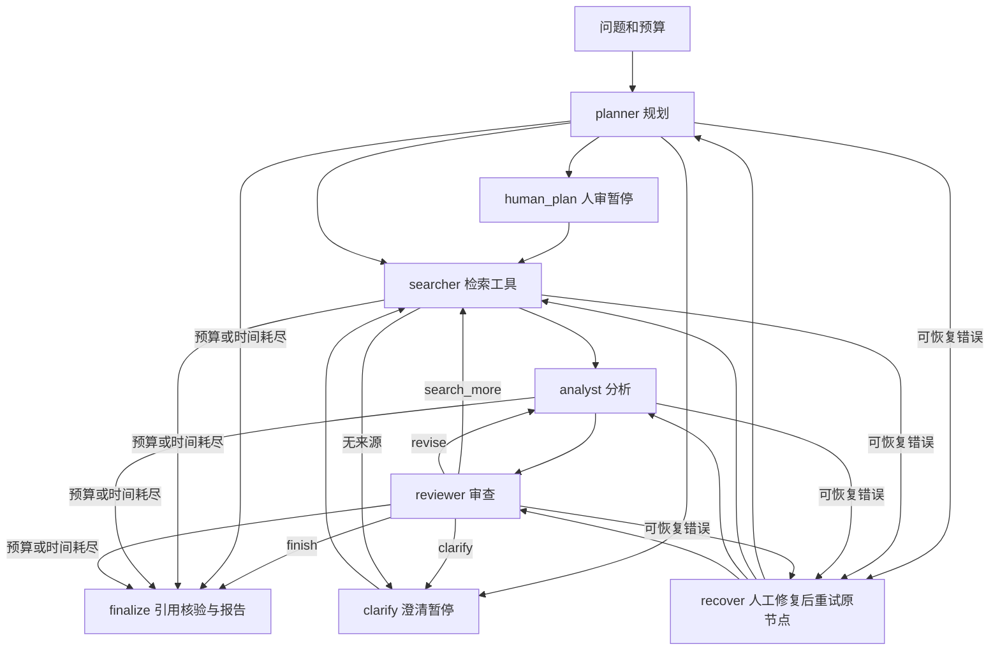

# AgentLab · 可观察、可恢复的多智能体研究工作台

把一个研究问题交给规划、检索、分析、审查四个角色；观察真正的条件分支，审核和编辑计划，查看带来源的报告。独立 FastAPI 项目，默认端口 **8811**，与其他项目没有数据库、虚拟环境或运行依赖共享。

## 先运行一次

需要 Python 3.10+，推荐 3.12。Windows 双击 **`启动.cmd`**，浏览器访问 **http://127.0.0.1:8811**。首次启动会创建本项目 `.venv` 并安装依赖。

Git Bash / macOS / Linux：

```bash
bash start.sh
```

手动安装，适合精确复现：

```bash
python -m venv .venv
# Windows Git Bash
.venv/Scripts/python -m pip install -r requirements.lock
.venv/Scripts/python run.py
# Linux/macOS 对应 .venv/bin/python
```

1. 在首页输入问题。默认 **离线演示**，无需任何账号或密钥。
2. 可在「演示场景」选择 **审查返工 / 补充检索 / 请求澄清**，看到真实图分支。它们是显式固定夹具，不是模型质量实验。
3. 点击「开始研究」，在暂停面板逐行编辑计划，填写新的研究方向，然后「确认并继续」。
4. 完成后查看研究报告、证据来源、执行日志和冻结配置。导出 Markdown 或 JSON。
5. 关闭并重启服务，左栏打开原任务。暂停任务可继续；意外中断任务显示「从检查点继续」。

默认只监听本机。不要把这个无用户登录的单人开发工具直接暴露到公网。

## 演示、真实检索与真实模型的边界

| 模式 / 证据 | 能说明什么 | 不能说明什么 |
|---|---|---|
| `mock` 离线演示 | 图路由、审核编辑、持久化、报告映射、前端全流程 | 真实搜索、真实模型能力、事实准确率、架构优越性 |
| `SearchClient('live')` | 实际向 Wikipedia 或 Tavily 发起检索，返回可追溯链接和片段 | 网页全文、来源权威性、逐项事实真伪 |
| `live` 真实模型 | 在用户显式选择后，用配置的 Qwen / Kimi 兼容接口执行 | 尚未运行时不能声称已经完成模型实验 |

本轮交付按用户选择完成 **mock 开发与验证**，没有调用真实模型或读取其他项目密钥。真实 Wikipedia 搜索适配已单独联网验证；模型 HTTP 协议可用本地夹具验证，二者均不等同真实模型研究 E2E。真实 15 题对照实验需后续用户配置模型并自行运行。

## 真实模型配置

把 `.env.example` 复制成 **本项目目录内**的 `.env`，自行填写 `QWEN_API_KEY` 或 `KIMI_API_KEY`、对应 `*_BASE_URL` 与 `*_MODEL`，重启服务后在界面选择「真实研究」。应用只加载本项目 `.env`，不会向父目录搜索密钥文件。

- Qwen 默认示例接口为 `https://dashscope.aliyuncs.com/compatible-mode/v1`。中国、新加坡、美国或专属工作空间的地址和密钥不同，应以账号所在地域的官方文档为准。
- Kimi 默认示例接口为 `https://api.moonshot.cn/v1`。示例模型名可覆盖；这些是兼容性示例，**不宣称是最新模型**。
- 模型接口必须 HTTPS；HTTP 错误正文、Authorization 和密钥不写入任务状态、日志或导出。
- 默认 Wikipedia 搜索不需要密钥，适合基础知识主题；对最新新闻、细分专业研究的召回能力有限。切换 `AGENTLAB_SEARCH=tavily` 并填 `TAVILY_API_KEY` 可使用网页搜索。
- 请求沿用标准代理环境。HTTP 超时与暂时性故障最多重试一次，每次都消耗预算。
- `*_INPUT_PRICE_PER_MILLION` / `*_OUTPUT_PRICE_PER_MILLION` 填写 **USD / 百万 token**。不填或 API 没有完整 usage 时，总费用和未知 token 显示未知，绝不使用 0 冒充已知费用。API 错误可能也有服务端计费，用量不可取得时总费用保留未知。

任务创建时冻结 provider、base URL、model、temperature、搜索引擎、价格和研究策略 SHA256，恢复时保留原配置；密钥在实际请求时从环境获得，不保存到数据库。响应中的实际 `model` / `system_fingerprint` 有返回才记录。

官方配置参考：[Qwen OpenAI 兼容接口](https://help.aliyun.com/zh/model-studio/compatibility-of-openai-with-dashscope)、[Kimi 平台文档](https://platform.kimi.com/docs/get-api-key)。

## 图结构与角色契约



| 角色 | 输入 | 输出和约束 | 工作流作用 |
|---|---|---|---|
| planner | 原问题、研究要求 | 最多 8 项计划、4 个搜索词、必要澄清 | 不同问题生成不同计划，决定是否人审或澄清 |
| searcher | 搜索词、已查询词、已有来源 | 执行真实搜索适配，URL 去重、最多 24 条资料 | 无资料时请求澄清；允许审查后补搜 |
| analyst | 计划、来源片段、上轮审查意见 | 结构化报告字段，来源编号 `[1]` | 按具体审查反馈重新分析 |
| reviewer | 草稿、原始片段、程序引用检查 | `finish / search_more / revise / clarify` | 输出直接控制条件边，不能只给一个聊天评价 |

底层可以共用一个模型，但每个角色有不同输入、JSON 契约、状态字段与执行权限。模型提出搜索词后由受限搜索适配执行，网页没有任意工具调用或代码执行权限。外部片段独立放在 `external_sources` 字段，并在系统指令中声明为不可信数据。应用本身没有执行网页指令、shell 或读取任意本地文件的工具。

### 两种工具调用方式

- 默认 `AGENTLAB_TOOL_MODE=json`：模型输出结构化搜索词，图的 searcher 节点调用搜索适配。兼容不支持 function calling 的接口；这是应用层的受限调度，**不冒充供应商原生 tool_calls**。
- `AGENTLAB_TOOL_MODE=native`：在本项目 `.env` 中开启并重启。检索角色向兼容接口发送真实 `tools=[search_web]`，读取模型返回的 `tool_calls`，校验函数名与参数，实际调用 `SearchClient`，再用 `role=tool`、对应 `tool_call_id` 回传真实来源。后续分析/审查节点也能读取这些来源。不是把 JSON 格式化函数冒充搜索工具。
- native 单 Agent 基线由同一个 single 控制器通过相同 `search_web` 工具检索、读取工具响应并生成报告，直接从 single 节点开始。最多每节点 3 轮工具交互 / 每轮 2 个搜索请求，同时仍受全局调用预算与超时限制。
- 模型必须支持 OpenAI 兼容的 `tools/tool_choice/tool_calls`；不支持时会明确报接口错误并暂停，用户可重新创建 json 模式任务。既有任务冻结工具模式，恢复时不会暗中更换。
- native 协议已通过本地 HTTP transport 夹具：模型发出 search_web → 搜索适配发出 HTTP → role=tool 返回来源 → 输出报告，single / multi 均覆盖；该测试不是供应商真实模型能力验证。

单 Agent 基线使用同一模型、温度、搜索适配、来源格式和总调用预算。它直接检索并生成报告，也可以要求补搜或澄清；没有规划角色和独立审查角色。两种架构都经过相同的程序引用映射检查。

## 持久化、限制与恢复

- `data/tasks.sqlite3`：任务历史、事件、请求配置、结果、每次调用尝试的持久账本。
- `data/checkpoints.sqlite3`：真正的 LangGraph `SqliteSaver` 文件检查点，固定 `thread_id=任务 id`；未使用内存模拟保存。
- `StateGraph` 使用条件边；人工审核使用 `interrupt()`，继续使用 `Command(resume=...)`。中断节点在恢复时会重跑，因此中断前不调用模型，不执行有费用的操作。
- 进程异常退出后，从最近**已完成节点**继续。进行中的请求可能已被上游执行，但回复未写入检查点；恢复会重试该节点。每次请求前的 SQLite 调用账本保留预算，真实请求的未知费用不会被重置或伪装为 0。外部模型供应商不提供本应用的 exactly-once 保证。
- 最大迭代 1–8 轮、总调用 1–40 次、执行时间 5–600 秒，模型/搜索重试包含在总预算。预算耗尽会交付「未完成」草稿与原因。人工等待不计执行时间。
- 停止任务会在当前有超时限制的网络请求结束后生效。请求使用剩余预算作为网络超时；正在执行的同步网络 I/O 不能被浏览器即时强杀。
- API 断线不等于取消任务。用历史和 `run_id` 取回状态。benchmark 相同外部 task_id + 请求配置重试返回已有任务，避免静默重复计费；运行中返回 409 与 run_id。
- `LANGGRAPH_STRICT_MSGPACK=true`，状态仅存 JSON 兼容数据。不要导入不信任来源的数据库。备份时先停止服务，再复制整个 `data` 目录。

## 引用核验的实际范围

报告必须引用输入来源编号。程序检查有没有引用、编号是否存在、引用与 URL / 检索片段是否对应。不存在的 `[99]` 会覆盖模型的「通过」判断，强制返工；达到上限仍不通过则保留警告。

`all_mapped=true` 表示编号映射通过；`retrieval_verified=true` 只表示用到的资料确实来自当前搜索适配的响应；`claim_truth_verified=false` 始终提醒尚无逐项客观事实证明。搜索片段不是网页全文，审查模型也不是金标准。高风险研究需要人工检查原文与独立证据。

## API 与另一个项目连接

打开 **http://127.0.0.1:8811/docs** 查看带类型约束的交互文档。

| 接口 | 用途 |
|---|---|
| `GET /api/health` | 服务、搜索提供商和密钥是否配置（不返回密钥） |
| `POST /api/tasks` | 创建后台任务，返回 id |
| `GET /api/tasks` / `GET /api/tasks/{id}` | 历史、状态、检查点、来源、事件 |
| `GET /api/tasks/{id}/events` | SSE 进度；支持 Last-Event-ID |
| `POST /api/tasks/{id}/resume` | `{direction, plan}` 审核/澄清/恢复 |
| `POST /api/tasks/{id}/stop` | 请求在当前调用结束后停止 |
| `GET /api/tasks/{id}/export?format=markdown\|json` | 导出报告、来源与实验配置 |
| `POST /api/benchmark/run` | 同步单 / 多 Agent 对照协议 |

示例：

```json
{
  "task_id": "experiment-001-case-01-repeat-1",
  "question": "SQLite 与 PostgreSQL 适合哪些本地应用场景？",
  "mode": "multi",
  "execution_mode": "mock",
  "provider": "qwen",
  "max_calls": 12,
  "timeout_seconds": 120,
  "temperature": 0,
  "research_instructions": "说明适用边界、反例和证据来源。"
}
```

`task_id` 是外部运行键。一次新实验或重复采样请生成新的 task_id；同 task_id 不同 prompt / mode 由完整配置 SHA256 分开，同配置请求重试会复用已有结果。benchmark 自动跳过计划人审；若模型主动要求澄清或执行错误，返回 `paused`、`success=false`，不会捏造完整结果。

响应：`schema_version=1.0`、原 task_id、内部 run_id、mode、execution_mode、output、sources、metrics、trace、citation_check。metrics 含实际模型调用、模拟调用、搜索调用、token、耗时、估算 USD 和任务是否结束；`success` **仅为工程完成**，不是答案质量分。未知 token/成本为 null。

`research_instructions` 会进入单 / 多模式每个模型节点的 payload，原问题保持独立用于搜索。指令 SHA256 记录在 trace 和冻结配置，支持 Benchmark Studio 的三提示词策略对照。它是补充研究要求，不能覆盖系统的工具权限和证据边界。

## 15 题可重复对照实验

`examples/research_tasks.json` 包含技术、基础科学、研究方法、能源、历史等简单和复杂任务及人工评价要点。运行前保持两个模式的模型、温度、搜索、题目、预算和评分标准一致，并按难度分组。质量、准确性和引用支持关系需独立人工或有金标准的评审，模型自评不能替代。

```bash
# 先启动 run.py，再运行。默认 mock；结果明确标为工程演示。
.venv/Scripts/python scripts/compare.py --execution-mode mock --output data/experiments/demo.json
# 后续自行配好模型与搜索后，显式选择 live；这会消耗 API 额度。
.venv/Scripts/python scripts/compare.py --execution-mode live --provider qwen --output data/experiments/live.json
```

脚本记录所有原始报告、来源、配置、模式、调用统计与难度分组汇总。没有真实运行就没有真实实验结论；mock 汇总不会生成「准确率」或「多 Agent 更好」的假结论。更全面的模型×提示词×样本评测可通过 LLM Benchmark Studio 的 AgentLab provider 连接本服务。

## 验证与开发

```bash
.venv/Scripts/python -m pytest -q
```

覆盖真实 LangGraph 节点与引用门禁、`search_more/revise/clarify/finish`、人工编辑、迭代/调用/超时限制、真实 HTTP 协议的本地 transport 夹具、有限重试、未知 usage / 成本、安全 Host、SSE、导出、追问、幂等，以及两类真实进程恢复：

1. 进程 A 暂停后退出，进程 B 读取同一文件检查点并恢复，保留人工方向和计划。
2. 在分析节点运行期间强制终止 OS 进程，另一个进程从检索后的检查点继续，已完成的规划 / 搜索不重复执行。

GitHub Actions 在 Windows / Ubuntu 的 Python 3.12 上运行核心测试。`requirements.txt` 固定直接依赖，`requirements.lock` 固定本次完整依赖树。

关键实现：`agentlab/engine.py` 图和角色；`providers.py` 模型/搜索；`storage.py` 持久化；`api.py` API/SSE；`web/` 中文工作台；`tests/` 行为、协议与跨进程恢复测试。

版本依据（2026-10-14）：[LangGraph 1.2.15](https://pypi.org/project/langgraph/1.2.15/)、[SQLite checkpointer 3.1.2](https://pypi.org/project/langgraph-checkpoint-sqlite/3.1.2/)、[官方 interrupt / Command 恢复语义](https://reference.langchain.com/python/langgraph/types/interrupt)。

MIT License。
