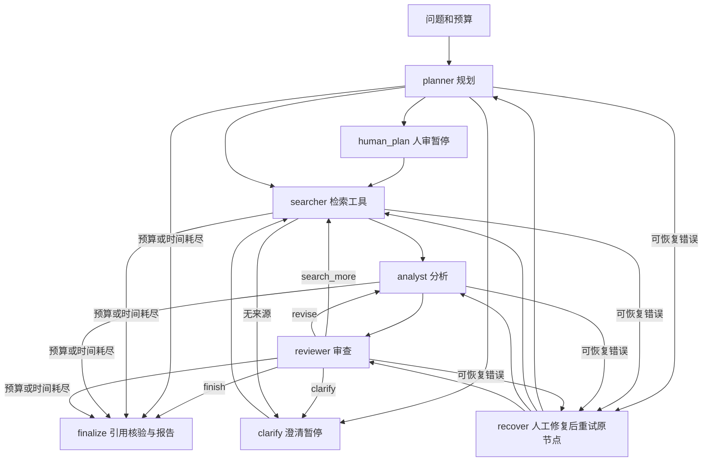

# AgentLab · 可观察、可恢复的多智能体研究工作台

> 2026-10-15 修复说明与当前本机验收：[使用、恢复和验收记录](docs/验收与恢复_2026-10-15.md)。历史章节中的测试数字保留为当时快照；真实云端模型验证仍待具体授权。

把一个研究问题交给规划、检索、分析、审查四个角色；观察真正的条件分支，审核和编辑计划，查看带来源的报告。独立 FastAPI 项目，默认端口 **8811**，与其他项目没有数据库、虚拟环境或运行依赖共享。

## 先运行一次

需要 Python 3.10+，推荐 3.12。Windows 双击 **`启动.cmd`**，浏览器访问 **http://127.0.0.1:8811**。首次启动会创建本项目 `.venv` 并安装依赖。

Git Bash / macOS / Linux：

```bash
bash start.sh
```

手动安装，适合精确复现：

```bash
python -m venv .venv
# Windows Git Bash
.venv/Scripts/python -m pip install -r requirements.lock
.venv/Scripts/python run.py
# Linux/macOS 对应 .venv/bin/python
```

1. 在首页输入问题。默认 **离线演示**，无需任何账号或密钥。
2. 可在「演示场景」选择 **审查返工 / 补充检索 / 请求澄清**，看到真实图分支。它们是显式固定夹具，不是模型质量实验。
3. 点击「开始研究」，在暂停面板逐行编辑计划，填写新的研究方向，然后「确认并继续」。
4. 完成后查看研究报告、证据来源、执行日志和冻结配置。导出 Markdown 或 JSON。
5. 关闭并重启服务，左栏打开原任务。暂停任务可继续；意外中断任务显示「从检查点继续」。

默认只监听本机。浏览器通过随机 HttpOnly、SameSite=Strict 会话 cookie 隔离模型和任务；这仍是本地工具，没有公网账号登录。升级前的单用户研究记录保留在原数据库，在「模型配置」显式认领一次后仅当前浏览器可查看。

## 演示、真实检索与真实模型的边界

| 模式 / 证据 | 能说明什么 | 不能说明什么 |
|---|---|---|
| `mock` 离线演示 | 图路由、审核编辑、持久化、报告映射、前端全流程 | 真实搜索、真实模型能力、事实准确率、架构优越性 |
| `SearchClient('live')` | 实际向 Wikipedia 或 Tavily 发起检索，返回可追溯链接和片段 | 网页全文、来源权威性、逐项事实真伪 |
| `live` 真实模型 | 在用户显式选择后，用网页配置的 Kimi / Qwen / DeepSeek / GLM / OpenAI / Anthropic / 自定义接口执行 | 尚未运行时不能声称已经完成模型实验 |

本次升级通过离线演示、注入 HTTP transport 的供应商协议与安全夹具验证，没有调用真实付费模型或读取其他项目密钥。用户将在网页填写自己的密钥后进行真实验收；本地协议夹具通过不代表任何供应商的实际可用性、模型能力或临床准确率。

## 真实模型配置

1. 打开左栏「模型配置」，填写名称、提供商、模型 ID、基础地址和 API 密钥；密钥有显示开关，保存后输入框会清空。
2. 设置温度、输出 token 上限、工具能力与模式。没有原生 function calling 能力的型号使用 JSON 模式；不接受温度参数的推理型号取消「发送温度参数」。Anthropic 温度为 0–1，其他兼容接口按各自文档填写。
3. 保存后可「测试连接 · 真实 API」。这是对实际模型发送一条最小请求，可能收费；界面分别报告 401 密钥、403 权限、404 路径/模型、429 额度/频率、超时、网络和响应格式错误。测试结果按配置版本保存；编辑配置后旧测试结果失效。
4. 设为默认模型，在新研究中选择「真实研究」和对应配置后开始。既有任务会继续使用创建时的配置与凭证标识。

密钥只放在后端内存；浏览器不写 localStorage，数据库、LangGraph 检查点、日志和导出均不保存密钥。服务重启后，模型定义与任务仍在，需要在同一浏览器重新填写密钥。较早任务使用的凭证 ID 可在原任务「配置」中查看，再在模型表单「恢复较早任务的密钥」补回。删除密钥后，恢复任务会以 `credential_missing` 暂停，不会换用新默认模型、其他版本密钥或环境密钥；已经发出的请求需要等当前有超时限制的调用结束。

原 `.env` 配置仍兼容：应用只加载**本项目目录内**的 `.env`，不会搜索父目录或兄弟项目。普通 import 与测试不读取 `.env`；仅 `run.py` 正式启动路径加载。网页「已有本项目 .env 配置」可显式认领环境凭证；环境凭证绑定一个持久本机会话（覆盖所有提供商），其他会话不能借用。模型凭证来源显式保存为 `web` / `env_import` / `legacy_unclassified`，不从 provider 名称推断。

- Qwen 默认示例接口为 `https://dashscope.aliyuncs.com/compatible-mode/v1`。中国、新加坡、美国或专属工作空间的地址和密钥不同，应以账号所在地域的官方文档为准。
- Kimi 默认示例接口为 `https://api.moonshot.cn/v1`。示例模型名可覆盖；这些是兼容性示例，**不宣称是最新模型**。
- 模型接口必须为公网 HTTPS，禁止账号/查询参数/片段、私有/回环/链路本地/保留/组播地址。连接时校验所有 A / AAAA DNS 答案，并连接已经检查的 IP，TLS SNI 与 Host 保持原域名，禁止代理环境绕过和跟随重定向。只有代码显式注入 `httpx.MockTransport` 测试夹具时可以允许 localhost HTTP，生产服务没有该开关。
- 默认 Wikipedia 搜索不需要密钥，适合基础知识主题；对最新新闻、细分专业研究的召回能力有限。切换 `AGENTLAB_SEARCH=tavily` 并填 `TAVILY_API_KEY` 可使用网页搜索。
- 模型 HTTP 超时与暂时性故障最多重试一次，每次都消耗预算。HTTP 错误正文、Authorization、密钥和原始异常不显示或保存；供应商响应中意外回显的当前密钥也会先被清洗。
- 网页价格填写 **USD / 百万 token**，未知时留空。没有完整 usage 时 token 和费用保持未知；Anthropic 输入 token 包含未缓存、缓存写入和缓存命中部分。存在缓存 usage 但没有缓存专用单价时费用保持未知，而且不会被后续可计量请求覆盖为已知总价。重试失败或上游可能计费但未返回 usage 时，总费用同样未知。

任务创建时冻结 `id/provider/protocol/model/base_url/config_version/credential_id/supports_tools/temperature/max_tokens`，以及工具模式、温度能力、搜索引擎、价格和研究策略 SHA256。编辑模型会递增版本；更换内存中现存密钥会创建新凭证 ID，旧任务保留自己的 ID。恢复原 ID 时用户需要自行提供原密钥，后端不会从其他模型寻找替代。响应中的实际 `model` / `system_fingerprint` 有返回才记录。

官方配置参考：[Qwen OpenAI 兼容接口](https://help.aliyun.com/zh/model-studio/compatibility-of-openai-with-dashscope)、[Kimi 平台文档](https://platform.kimi.com/docs/get-api-key)、[OpenAI Chat Completions](https://developers.openai.com/api/reference/resources/chat/subresources/completions/methods/create)、[Anthropic Messages](https://platform.claude.com/docs/en/api/messages/create)、[Anthropic 工具调用](https://platform.claude.com/docs/en/agents-and-tools/tool-use/handle-tool-calls)。预设型号仅为可编辑示例，不宣称是最新型号或在当前账号可用。

## 图结构与角色契约



| 角色 | 输入 | 输出和约束 | 工作流作用 |
|---|---|---|---|
| planner | 原问题、研究要求 | 最多 8 项计划、4 个搜索词、必要澄清 | 不同问题生成不同计划，决定是否人审或澄清 |
| searcher | 搜索词、已查询词、已有来源 | 执行真实搜索适配，URL 去重、最多 24 条资料 | 无资料时请求澄清；允许审查后补搜 |
| analyst | 计划、来源片段、上轮审查意见 | 结构化报告字段，来源编号 `[1]` | 按具体审查反馈重新分析 |
| reviewer | 草稿、原始片段、程序引用检查 | `finish / search_more / revise / clarify` | 输出直接控制条件边，不能只给一个聊天评价 |

底层可以共用一个模型，但每个角色有不同输入、JSON 契约、状态字段与执行权限。模型提出搜索词后由受限搜索适配执行，网页没有任意工具调用或代码执行权限。外部片段独立放在 `external_sources` 字段，并在系统指令中声明为不可信数据。应用本身没有执行网页指令、shell 或读取任意本地文件的工具。

### 两种工具调用方式

- 默认 `AGENTLAB_TOOL_MODE=json`：模型输出结构化搜索词，图的 searcher 节点调用搜索适配。兼容不支持 function calling 的接口；这是应用层的受限调度，**不冒充供应商原生 tool_calls**。
- `AGENTLAB_TOOL_MODE=native`：在本项目 `.env` 中开启并重启。检索角色向兼容接口发送真实 `tools=[search_web]`，读取模型返回的 `tool_calls`，校验函数名与参数，实际调用 `SearchClient`，再用 `role=tool`、对应 `tool_call_id` 回传真实来源。后续分析/审查节点也能读取这些来源。不是把 JSON 格式化函数冒充搜索工具。
- native 单 Agent 基线由同一个 single 控制器通过相同 `search_web` 工具检索、读取工具响应并生成报告，直接从 single 节点开始。最多每节点 3 轮工具交互 / 每轮 2 个搜索请求，同时仍受全局调用预算与超时限制。
- OpenAI 兼容协议采用 `tools/tool_choice/tool_calls`，工具参数先验证 JSON、schema、全部调用 ID 和函数白名单，再执行搜索；`content=null` 和多个工具调用可正确回传。官方 OpenAI provider 使用 `max_completion_tokens`，兼容 provider 使用 `max_tokens`。
- Anthropic 使用原生 `/messages`、顶层 `system`、`x-api-key` 和 `anthropic-version`；`tool_use` 转为受限调用，搜索结果用紧随其后的 user `tool_result(tool_use_id)` 内容块返回。不是给 Anthropic 换成 Bearer header 后继续发送 OpenAI 请求。
- 模型须显式声明支持相应工具能力；不支持时明确暂停，用户可创建 JSON 模式任务。既有任务冻结工具模式，恢复时不会暗中更换。
- native 协议已通过本地 HTTP transport 夹具：模型发出 search_web → 搜索适配发出 HTTP → role=tool 返回来源 → 输出报告，single / multi 均覆盖；该测试不是供应商真实模型能力验证。

单 Agent 基线使用同一模型、温度、搜索适配、来源格式和总调用预算。它直接检索并生成报告，也可以要求补搜或澄清；没有规划角色和独立审查角色。两种架构都经过相同的程序引用映射检查。

## 持久化、限制与恢复

- `data/tasks.sqlite3`：任务历史、事件、请求配置、结果、每次调用尝试的持久账本、会话 token 的不可逆 hash 和非敏感模型定义。原始会话 cookie、模型密钥和联动令牌不保存到 SQLite。
- `data/checkpoints.sqlite3`：真正的 LangGraph `SqliteSaver` 文件检查点，固定 `thread_id=任务 id`；未使用内存模拟保存。
- `StateGraph` 使用条件边；人工审核使用 `interrupt()`，继续使用 `Command(resume=...)`。中断节点在恢复时会重跑，因此中断前不调用模型，不执行有费用的操作。
- 进程异常退出后，从最近**已完成节点**继续。进行中的请求可能已被上游执行，但回复未写入检查点；恢复会重试该节点。每次请求前的 SQLite 调用账本保留预算，真实请求的未知费用不会被重置或伪装为 0。外部模型供应商不提供本应用的 exactly-once 保证。
- 最大迭代 1–8 轮、总调用 1–40 次、执行时间 5–600 秒，模型/搜索重试包含在总预算。预算耗尽会交付「未完成」草稿与原因。人工等待不计执行时间。
- 停止任务会在当前有超时限制的网络请求结束后生效。请求使用剩余预算作为网络超时；正在执行的同步网络 I/O 不能被浏览器即时强杀。
- API 断线不等于取消任务。同一浏览器可用历史和 `run_id` 取回状态。列表、详情、SSE、导出、恢复、停止和追问父任务全部检查 owner；其他会话统一获得 404。benchmark 相同 owner + 外部 task_id + 冻结配置重试返回已有任务；不同会话不会读到其他用户结果，运行中返回 409 与 run_id。
- `LANGGRAPH_STRICT_MSGPACK=true`，状态仅存 JSON 兼容数据。不要导入不信任来源的数据库。备份时先停止服务，再复制整个 `data` 目录。

## 引用核验的实际范围

报告必须引用输入来源编号。程序检查有没有引用、编号是否存在、引用与 URL / 检索片段是否对应。不存在的 `[99]` 会覆盖模型的「通过」判断，强制返工；达到上限仍不通过则保留警告。

`all_mapped=true` 表示编号映射通过；`retrieval_verified=true` 只表示用到的资料确实来自当前搜索适配的响应；`claim_truth_verified=false` 始终提醒尚无逐项客观事实证明。搜索片段不是网页全文，审查模型也不是金标准。高风险研究需要人工检查原文与独立证据。

## API 与另一个项目连接

打开 **http://127.0.0.1:8811/docs** 查看带类型约束的交互文档。

| 接口 | 用途 |
|---|---|
| `GET /api/health` | 服务、搜索提供商和密钥是否配置（不返回密钥） |
| `POST /api/tasks` | 创建后台任务，返回 id |
| `GET /api/tasks` / `GET /api/tasks/{id}` | 历史、状态、检查点、来源、事件 |
| `GET /api/tasks/{id}/events` | SSE 进度；支持 Last-Event-ID |
| `POST /api/tasks/{id}/resume` | `{direction, plan}` 审核/澄清/恢复 |
| `POST /api/tasks/{id}/stop` | 请求在当前调用结束后停止 |
| `GET /api/tasks/{id}/export?format=markdown\|json` | 导出报告、来源与实验配置 |
| `POST /api/benchmark/run` | 同步单 / 多 Agent 对照协议 |
| `GET /api/models` / `POST /api/models` | 当前会话模型列表 / 添加模型 |
| `PUT /api/models/{id}` / `DELETE /api/models/{id}` | 修改版本 / 删除模型与内存凭证 |
| `POST /api/models/{id}/default` / `POST /api/models/{id}/test` | 默认模型 / 最小真实连接请求 |
| `DELETE /api/models/{id}/credential` / `POST /api/models/{id}/credentials` | 删除内存凭证 / 显式恢复原凭证 ID |
| `GET /api/history/unclaimed` / `POST /api/history/claim` | 升级前未归属记录数量 / 一次认领 |
| `POST /api/models/import-env/{provider}` | 显式认领旧本项目环境配置 |
| `POST /api/integration/grants` / `GET /api/integration/grants` / `DELETE /api/integration/grants/{id}` | 创建一次展示授权令牌 / 无令牌列表 / 撤销 |
| `GET /api/integration/model?model_config_id=...` | Bearer grant 授权读取所选模型非敏感定义 |

在模型卡片创建联动授权后，将界面一次展示的令牌和模型配置 ID 填入 Benchmark Studio 的 AgentLab 导入表单。Studio 服务器将令牌只保存在内存中，通过 Bearer grant 调用本项目；不传输模型密钥。令牌绑定当前 owner、所选配置版本与凭证 ID，有效 24 小时。撤销、服务重启、配置版本变化或凭证缺失会明确拒绝或暂停；已有任务不能暗中改用其他凭证。令牌不授权读取 cookie 会话的任务详情、导出或其他模型。

联动 benchmark body 增加 `model_config_id` 和 `expected_config_version`；后者不匹配会返回 409，且不会发送模型请求。成功响应另带本次实际冻结的 `model_config`，供实验追溯。网页任务默认使用当前会话 cookie，跨项目仅 `/api/integration/model` 与 `/api/benchmark/run` 接受限定范围的联动令牌。

示例：

```json
{
  "task_id": "experiment-001-case-01-repeat-1",
  "question": "SQLite 与 PostgreSQL 适合哪些本地应用场景？",
  "mode": "multi",
  "execution_mode": "mock",
  "provider": "qwen",
  "max_calls": 12,
  "timeout_seconds": 120,
  "temperature": 0,
  "research_instructions": "说明适用边界、反例和证据来源。"
}
```

`task_id` 是外部运行键。一次新实验或重复采样请生成新的 task_id；同 task_id 不同 prompt / mode 由完整配置 SHA256 分开，同配置请求重试会复用已有结果。benchmark 自动跳过计划人审；若模型主动要求澄清或执行错误，返回 `paused`、`success=false`，不会捏造完整结果。

响应：`schema_version=1.0`、原 task_id、内部 run_id、mode、execution_mode、output、sources、metrics、trace、citation_check。metrics 含实际模型调用、模拟调用、搜索调用、token、耗时、估算 USD 和任务是否结束；`success` **仅为工程完成**，不是答案质量分。未知 token/成本为 null。

`research_instructions` 会进入单 / 多模式每个模型节点的 payload，原问题保持独立用于搜索。指令 SHA256 记录在 trace 和冻结配置，支持 Benchmark Studio 的三提示词策略对照。它是补充研究要求，不能覆盖系统的工具权限和证据边界。

## 15 题可重复对照实验

`examples/research_tasks.json` 包含技术、基础科学、研究方法、能源、历史等简单和复杂任务及人工评价要点。运行前保持两个模式的模型、温度、搜索、题目、预算和评分标准一致，并按难度分组。质量、准确性和引用支持关系需独立人工或有金标准的评审，模型自评不能替代。

```bash
# 先启动 run.py，再运行。默认 mock；结果明确标为工程演示。
.venv/Scripts/python scripts/compare.py --execution-mode mock --output data/experiments/demo.json
# 后续自行配好模型与搜索后，显式选择 live；这会消耗 API 额度。
# 先在网页创建联动授权，再将一次展示的令牌设为当前终端环境变量 AGENTLAB_GRANT_TOKEN
.venv/Scripts/python scripts/compare.py --execution-mode live --model-config-id YOUR_CONFIG_ID --config-version 1 --output data/experiments/live.json
```

脚本记录所有原始报告、来源、配置、模式、调用统计与难度分组汇总。没有真实运行就没有真实实验结论；mock 汇总不会生成「准确率」或「多 Agent 更好」的假结论。更全面的模型×提示词×样本评测可通过 LLM Benchmark Studio 的 AgentLab provider 连接本服务。

## 界面设计

`web/` 为无构建步骤的中文研究工作台：深黑 / 深墨绿底色配青绿强调色，首屏以山脉与等高线地形图形表达研究探索的品牌视觉；左侧固定导航，研究问题输入区为创建页视觉中心，高级参数默认折叠。执行页用时间线节点展示 planner / searcher / analyst / reviewer 的真实状态（未开始 / 执行中 / 已完成 / 等待人工 / 失败，含耗时与事件明细），全部来自后端事件流，没有前端模拟进度；人工审核面板直接嵌入工作流。报告按标题层级、引用角标、来源列表与代码块排版，支持 Markdown / JSON 导出。界面适配桌面、平板与手机宽度，支持键盘焦点与系统减少动态设置。

## 验证与开发

```bash
# 默认测试入口：禁止 dotenv、清除继承凭证、阻断外部网络
.venv/Scripts/python -m pytest -q
```

测试隔离由 `tests/isolation.py` 提供：导入应用前清理全部模型 Key、搜索 Key、grant、代理和 live 开关；仅修改子进程环境，不改用户文件或系统环境变量。默认阻断未注册的外部连接（包括子进程恢复测试），本地夹具允许 loopback 服务（测试统一使用隔离目录与动态端口）。父进程放置多个假环境 Key 时，子测试仍不加载 `.env`，且任何未注入的模型/搜索请求立刻失败。

真实联网测试独立命名和显式 opt-in，不纳入默认 `pytest`、CI、安装自检或模型列表加载。

保留原工程测试，新增多供应商 CRUD、OpenAI / Anthropic 原生协议与工具循环、错误类别与回显秘密清洗、cookie / 模型 / 任务 / SSE / 导出 / 父任务 / benchmark owner 隔离、重启后定义保留与密钥丢失、冻结原版本 / 凭证恢复、DNS 全答案校验 / IP 固定连接、显式夹具开关、缓存费用未知保持、旧历史显式认领和联动版本漂移拒绝。还覆盖两类真实进程恢复：

1. 进程 A 暂停后退出，进程 B 读取同一文件检查点并恢复，保留人工方向和计划。
2. 在分析节点运行期间强制终止 OS 进程，另一个进程从检索后的检查点继续，已完成的规划 / 搜索不重复执行。

统计一致性测试覆盖五类 usage 夹具（带 usage、无 usage、429 后成功、缓存 token、超时），验证模型与搜索次数分开、未知费用不显示为免费。

GitHub Actions 在 Windows / Ubuntu 的 Python 3.12 上运行核心测试。`requirements.txt` 固定直接依赖，`requirements.lock` 固定本次完整依赖树。

关键实现：`agentlab/engine.py` 图和角色；`providers.py` 模型/搜索；`storage.py` 持久化；`api.py` API/SSE；`web/` 中文工作台；`tests/` 行为、协议与跨进程恢复测试。

版本依据（2026-10-14）：[LangGraph 1.2.15](https://pypi.org/project/langgraph/1.2.15/)、[SQLite checkpointer 3.1.2](https://pypi.org/project/langgraph-checkpoint-sqlite/3.1.2/)、[官方 interrupt / Command 恢复语义](https://reference.langchain.com/python/langgraph/types/interrupt)。

## 公平架构对照实验（A08）

`scripts/prepare_experiment.py` 生成可重放的实验计划：

```bash
.venv/Scripts/python scripts/prepare_experiment.py --repeats 2 --seed 20261015
```

输出 `examples/experiment_plan.json`，包含：
- 60 个执行单元（15 题 × single/multi × 2 次重复），带 `dataset_hash`、`prompt_hash`、代码 HEAD/dirty 状态、策略版本
- 冻结配置（温度、工具模式、搜索适配、内部调用上限），两架构共享
- 检索缓存 schema（query→片段/URL/hash），miss 策略对称执行，不一侧联网一侧用缓存
- 质量评价量表（5 维度 × 1-5 分），评分者为独立人工复核，非 Agent 自审

执行顺序按记录的 seed 随机化，single/multi 交替出现，不让一侧总先执行。runner 每单元完成后落盘，失败计入矩阵，重试同单元保持幂等 ID。

## 已知限制与待办

| 事项 | 状态 |
|---|---|
| 本地工程（A00–A08、A12） | 已完成 |
| 跨项目联动（A09） | 等待 Studio B13 共同契约 |
| 真实供应商小预算验收（A10） | `awaiting_live_authorization` |
| 真实 single/multi 对照（A11） | `awaiting_live_authorization` |
| 发布 | 未要求 |

真实供应商验证和对照实验需要明确的 provider/model/预算授权后才能执行。未经实际评阅的质量项记为未评，不拿自审结果填充。结果可以是无优势或多 Agent 更差，不能预设结论。

MIT License。
